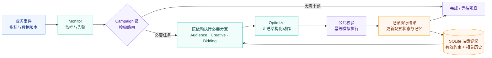

<div align="center">

# ADAgent

### 多 Agent 广告优化工作流

以更少的调用，完成有状态的多轮任务。

**按需路由 · 跨轮次去重 · 工具复用 · 选择性记忆**

[](python/requirements.txt)
[](python/src/workflow/engine.py)
[](python/src/workflow/memory.py)
[](https://github.com/gdisx088/multi-agent-ad-optimizer/actions/workflows/test.yml)
[](LICENSE)

[项目亮点](#features) · [系统架构](#architecture) · [实验结果](#results) · [快速开始](#quickstart) · [复现与审计](#reproduce)

</div>

---

基于开源广告优化项目重构的 **Python 多 Agent 系统**，围绕监控、受众分析、素材生成、出价和执行五类角色，解决固定流程执行冗余、重复工具查询与历史约束丢失问题。

项目提供可运行的 **LangGraph 工作流、SQLite 模拟环境、决策记忆和五组对照评测**，从原始调用轨迹验证优化效果。

> **实验边界**：真实 LLM + 合成业务数据 + 本地模拟工具。Creative 调用真实模型，其余角色采用确定性策略；结果衡量工作流效率与任务质量，不代表真实广告 CTR、ROAS 或生产收益。

<a id="features"></a>

## ✨ 项目亮点

| 优化方向 | 解决的问题 | 核心实现 |
|:---|:---|:---|
| **按需路由** | 一个异常触发全部角色执行 | `StateGraph` + 类型化共享状态 + 条件边，按 Campaign 选择必要分支 |
| **跨轮次去重** | 对相同证据反复生成和干预 | 证据、配置与依赖版本校验，结果复用及动作观察期 |
| **工具复用** | 多角色重复查询相同数据 | 批量读取、精确版本缓存、TTL 与并发同请求合并 |
| **选择性记忆** | 历史约束缺失或完整历史过长 | 结构化事件、Campaign 隔离、约束替代、Top-K 检索与 Token 预算 |

工具写入通过公共校验和幂等账本执行，支持响应丢失后的状态核查；原始模型输出、失败与重试均保留在追踪记录中。

<a id="architecture"></a>

## 🧭 系统架构



| 层次 | 职责 | 代码入口 |
|:---|:---|:---|
| **编排与状态** | 五角色节点、条件路由、任务依赖与执行状态 | [engine.py](python/src/workflow/engine.py) · [types.py](python/src/workflow/types.py) |
| **工具与业务环境** | 有状态模拟工具、读缓存、幂等账本和故障恢复 | [tools.py](python/src/workflow/tools.py) |
| **记忆与模型** | 历史筛选、上下文预算、模型协议与请求预算 | [memory.py](python/src/workflow/memory.py) · [llm.py](python/src/workflow/llm.py) |
| **评测与追踪** | 合成场景、独立评价器、对照运行与统计报告 | [benchmark/](python/src/benchmark) · [telemetry.py](python/src/workflow/telemetry.py) |

必要节点按依赖顺序执行，当前不并行调度 Agent。LangGraph 管理当前工作状态，SQLite 持久化业务状态与记忆；实验检查点记录进度，尚不支持 LangGraph 原生中断恢复。

<a id="results"></a>

## 📊 实验结果

使用真实 **DeepSeek `deepseek-flash`**，在七类合成场景中完成：

**21 个独立案例 × 3 次重复 × 5 组对照 = 315 组运行**

| LLM 请求减少 | 后端读取减少 | 输入 Token 减少 |
|:---:|:---:|:---:|
| **52.6%** | **38.7%** | **51.3%** |
| 固定流程 → 按需执行与去重 | 加入工具读取复用 | 完整历史 → 选择性记忆 |
| 1,116 → 196 次 | 675 → 414 次 | 157,161 → 76,611 Token |

最终 B3 方案通过 **63/63 次案例运行**，必要分支完成 **378/378**；

这些数字是本轮热缓存条件下的样本结果。读取节省未达到原定 50% 目标；记忆类只有 3 个独立案例，Token 下降率的 95% 置信区间为 **0.0%～64.6%**。63 次运行不是 63 个独立案例。

<details>
<summary><strong>展开五组对照、成功判定与统计口径</strong></summary>
<br/>

| 组别 | 策略 | 成功运行 | LLM 请求 | 后端读取 | 输入 Token |
|:---|:---|---:|---:|---:|---:|
| B0 | 修正后的固定五节点流程 | 9/63 | 1,116 | 3,024 | 257,280 |
| B1 | 按需路由、去重与等待 | 54/63 | 196 | 675 | 41,358 |
| B2 | B1 + 读取复用 | 54/63 | 195 | 414 | 41,358 |
| **B3** | **B2 + 选择性记忆** | **63/63** | **171** | **414** | **76,611** |
| M-Full | B2 + 完整有效历史 | 63/63 | 171 | 414 | 157,161 |

- 各组、各案例及每次重复均独立初始化状态；warm 缓存仅在同一案例的事件间保留。
- LLM 请求含失败和重试。B1 比 B2 多一次请求，来自传输失败重试，不能归因于工具复用。
- 所有组必要分支均完成 378/378。B0 主要因不必要提案及历史约束违规而失败，并非没有执行必要分支。
- 各组共用幂等保护，重复实际执行均为 0；“重复决策”与“重复执行”分开统计。
- 置信区间按案例聚类 Bootstrap 计算，三次重复不会被当作三个独立案例。

</details>

**查看证据：** [结果解读与置信区间](docs/validation-21-results.md) · [预设实验方案](docs/validation-21-protocol.md) · [原始数据与压缩轨迹](results/validation-21/README.md)

<a id="quickstart"></a>

## 🚀 快速开始

### 1. 获取项目

需要 **Python 3.12**，已验证版本为 3.12.14。离线验证无需模型密钥、广告账号或独立数据库服务。

```bash
git clone https://github.com/gdisx088/multi-agent-ad-optimizer.git
cd multi-agent-ad-optimizer
```

### 2. 安装并运行离线验证

<details open>
<summary><strong>Windows · PowerShell</strong></summary>

```powershell
py -3.12 -m venv .venv
.\.venv\Scripts\python.exe -m pip install -r python/requirements.txt
$env:PYTHONPATH = "python"
$env:PYTHONIOENCODING = "utf-8"

# 检查冻结测试集
.\.venv\Scripts\python.exe -m src.benchmark validate --config configs/offline-test.json

# 运行小规模五组对照
.\.venv\Scripts\python.exe -m src.benchmark run --config configs/offline-smoke.json
```

</details>

<details>
<summary><strong>Linux / macOS · Bash</strong></summary>

```bash
python3.12 -m venv .venv
source .venv/bin/activate
python -m pip install -r python/requirements.txt
export PYTHONPATH=python
export PYTHONIOENCODING=utf-8

# 检查冻结测试集
python -m src.benchmark validate --config configs/offline-test.json

# 运行小规模五组对照
python -m src.benchmark run --config configs/offline-smoke.json
```

</details>

**预期结果：** `validate` 检查 210 个案例、1,260 个事件，输出 `success: true`；`offline-smoke` 完成七个开发案例的五组冷/热缓存对照，共 70 组运行，报告写入 `artifacts/offline-smoke/`。

离线模式采用固定模型响应，真实 LLM 请求数为 0；它验证流程正确性，不衡量真实生成质量。tiktoken 首次使用可能下载编码文件，之后使用本地缓存。

### 3. 接入真实 LLM（可选）

复制 [.env.example](.env.example) 为 `.env`，填写供应商配置。适配器使用 OpenAI 兼容的 Chat Completions 接口，所有比较组使用同一模型。

```dotenv
LLM_BASE_URL=https://your-provider.example/v1
LLM_MODEL=your-model
LLM_API_KEY=your-key
```

完成环境设置后，选择与供应商匹配的 pilot 配置：

```bash
# 通用 OpenAI 兼容接口
python -m src.benchmark run --config configs/live-pilot.json

# DeepSeek：显式关闭思考模式，正文输出上限为 1,200 Token
python -m src.benchmark run --config configs/deepseek-pilot.json
```

Windows 使用 `.\.venv\Scripts\python.exe` 替换 `python`。上述两条命令按供应商二选一即可。配置中包含请求数与 Token 上限，重试计入预算；缺少配置、认证失败及输出截断会显式报错。未设置单价时仅报告 Token。

<details>
<summary><strong>展开全部实验配置与运行规模</strong></summary>

<br/>

| 配置 | 用途 | 规模 / 状态 |
|:---|:---|:---|
| `offline-dev.json` / `offline-test.json` | 开发集 / 冻结测试集验证 | 70 / 210 个案例 |
| `offline-smoke.json` | 离线五组冷/热缓存对照 | 70 组运行 |
| `live-pilot.json` / `deepseek-pilot.json` | 通用接口 / DeepSeek pilot | 七案例 × 五组 × 一次重复 |
| `deepseek-validation-21.json` | 本仓库展示的真实实验 | 315 组，已完成 |
| `memory-pilot.json` / `deepseek-memory-pilot.json` | 固定外部历史的记忆专项 | 对应真实实验尚未运行 |
| `live-test.json` / `deepseek-test.json` | 全量真实实验 | 6,300 组，尚未运行 |

配置文件位于 [configs/](configs)。扩大规模前根据已有消耗设置预算；配置上限不代表预计用量。仅显式运行 live 配置时才会调用真实模型。

</details>

<a id="reproduce"></a>

## 🔬 复现与审计

### 核验已有结果

无需再次调用模型，即可检查已发布的 315 组实验：

```bash
python scripts/verify-experiment.py --run-dir results/validation-21
```

预期返回 `verified: true`、21 个独立案例、315 组运行和 1,849 次请求。脚本直接读取 `traces.zip`，核对代码/数据快照哈希、任务覆盖、请求/响应/失败次数、Token 与后端计数。

### 运行测试与生成报告

在项目根目录、完成上述环境设置后执行：

```bash
python -m pytest -q
python -m src.benchmark report --run-dir artifacts/offline-smoke/实际运行目录
```

Windows 同样使用 `.\.venv\Scripts\python.exe`。GitHub Actions 自动执行测试、冻结测试集离线验证和结果审计，无需模型密钥。

<details>
<summary><strong>每次实验保存哪些记录？</strong></summary>

<br/>

| 记录 | 内容 |
|:---|:---|
| `manifest.json` | 配置、模型、依赖版本、代码/数据/提示词哈希 |
| `scenarios.json` | 场景输入和独立评价规则 |
| `source-snapshot.zip` | 本次实验使用的代码快照 |
| `traces/*.jsonl` | 上下文、原始输出、路由、模型与工具调用 |
| `states/*.sqlite` | 业务状态、决策记忆与执行账本 |
| `cases.jsonl` / `summary.*` / `report.md` | 案例判定、统计明细和报告 |
| `checkpoint.json` | 进度、预算计量及中断位置 |

新结果写入独立的 `artifacts/` 目录，不覆盖已发布结果包。公开包将轨迹无损压缩为 `traces.zip`，SQLite 状态仅在原本地目录保留。

在运行目录创建空文件 `STOP`，可在下一事件边界停止。检查点保留中断信息，当前不自动续跑付费任务。

</details>

<a id="structure"></a>

## 📁 项目结构

```text
multi-agent-ad-optimizer/
├── python/
│   ├── src/
│   │   ├── workflow/         # LangGraph、模型、工具、记忆与追踪
│   │   ├── benchmark/        # 场景、评价器、运行器与统计报告
│   │   └── orchestrator/     # Python Supervisor 调用入口
│   ├── tests/               # 离线单元与集成测试
│   └── requirements*.txt    # 依赖入口与版本锁定
├── configs/                 # 离线与真实模型实验配置
├── datasets/manifest.json   # 冻结数据集版本与哈希
├── results/validation-21/   # 已审核结果与压缩原始轨迹
├── docs/                    # 架构、评测方案和结果解读
├── scripts/                 # 实验审计
├── .github/workflows/       # 自动测试与离线验证
├── .env.example             # 模型配置模板
├── UPSTREAM.md              # 上游来源与改造范围
└── LICENSE                  # MIT
```

本地密钥、虚拟环境、缓存、SQLite 文件、`artifacts/` 和 `.research/` 均不纳入 Git。

## 📚 文档导航

| 想了解什么 | 从这里开始 |
|:---|:---|
| 节点、状态、工具与记忆如何实现 | [架构与指标口径](docs/architecture-and-evaluation.md) |
| 对照组、案例和统计方法如何确定 | [实验预设方案](docs/validation-21-protocol.md) |
| 优化效果、失败原因与结论边界 | [实验结果与局限](docs/validation-21-results.md) |
| 如何追溯和核验原始数字 | [可核验结果包](results/validation-21/README.md) |
| 开源来源、基线与本项目改造范围 | [上游说明](UPSTREAM.md) |

---

基于 [bcefghj/multi-agent-ad-optimizer](https://github.com/bcefghj/multi-agent-ad-optimizer) 改造，仅维护 Python 版本，保留上游 **MIT License**。来源、固定提交和基线口径见 [UPSTREAM.md](UPSTREAM.md)。

<div align="center">

[返回顶部 ↑](#adagent)

</div>
