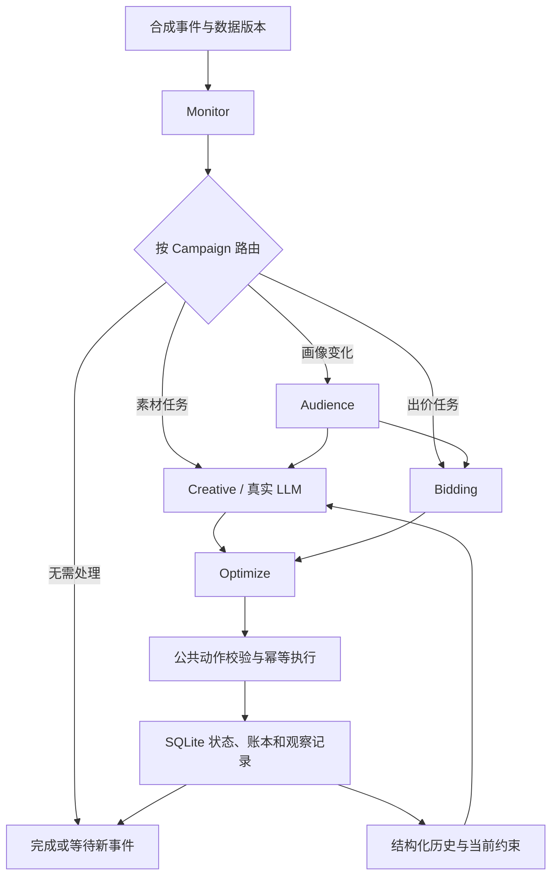

# 架构、运行方式和指标口径

## 实现结构

`python/src/workflow` 实现 Monitor、Audience、Creative、Bidding、Optimize 五个业务角色。`python/src/orchestrator/supervisor.py` 提供 Python 调用入口，`python/src/benchmark` 提供场景运行与评测命令。上游来源和固定提交见 [UPSTREAM.md](../UPSTREAM.md)。

核心流程：业务事件 → SQLite 快照导入 → Monitor → 规则路由 → 按依赖执行必要节点 → Optimize 形成动作 → 公共执行器 → 账本与观察状态。

图示表达依赖关系；实际 v1 的必要节点按 Audience → Creative → Bidding 顺序执行，不把图中的分支误解为并行。

LangGraph 使用明确的 TypedDict 状态字段，因此节点局部更新保留其他字段。B0 固定经过五节点，其他组使用条件边真正跳过不必要的节点，而不是进入节点后才退出。每个 Campaign 的任务有独立路由和证据指纹。第一版按 Campaign 的相关证据整体失效，暂未细化到每个指标字段的最小依赖。

Monitor/Bidding 使用确定性合成策略；Creative 才调用模型。预算、出价和业务指标只是工作流测试载体，合成策略不作为真实投放算法。

## 工具和事务边界

`SimulatedWorld` 使用 SQLite 存储 Campaign 快照、可变对象状态、执行账本和记忆。每个案例、重复、实验组与缓存条件使用独立数据库，避免组间污染。

读取工具为 metrics、campaign_state、audience_age、audience_device。受众工具按 Campaign 集合查询，一个年龄批次与一个设备批次共两次实际请求；不复用组逐 Campaign 调用这两个工具。

`ToolExecutor` 规范化 ID 集合，用工具/参数/证据版本/配置版本构成缓存键。业务时钟控制 TTL。返回缓存副本，避免调用者修改缓存；Future 合并同一时刻的相同请求；错误和不完整响应不进入缓存。瞬时读取错误最多追加两次尝试。

写操作经过 `ActionExecutor`，不使用读取缓存。动作键包含事件、Campaign、操作、目标与动作内容。业务变更与幂等账本写入同一 SQLite 事务。执行成功但响应丢失时先查账本，未确认成功才重试。无幂等模式只在故障专项测试中启用。

人工设定的故障包括调用前超时、暂时失败、不完整响应、提交后丢失响应。默认不注入人为延迟。工具记录是本地后端请求次数，不等于 SQLite 所有内部管理 SQL 的数量；记忆查询、数据初始化和账本维护有独立语义，不能冒充业务工具调用。

## 路由和记忆

- 完全相同的证据、配置与任务不重复执行已完成任务。
- 观察期内相同策略等待，紧急事件与新约束允许重新评估。
- 过观察期但证据不变仍复用；新数据版本或依赖版本引发重新执行。
- 稳定活动可以因显式任务、画像到期或周期复查进入相应分支。
- 公共执行器按有效约束阻止不合规写入；原始模型输出仍参与评价。

三种上下文：none 没有历史；full 包含所有未过期、未替代的本活动记录；selective 保留全部硬约束/有效观察事项，再按任务相关性和时间选择最多 5 条可选历史。2,000 Token 只限制可选历史，不用于删除必要约束。

当前明确约束优先于冲突的历史词项。历史替代通过同 Campaign 的 supersedes 建立；过期以模拟时钟判断；未来记录不允许提前注入。不引入语义向量检索或模型摘要。

历史完整模式超出上下文容量会失败并计入质量结果，不进行隐式截断。Token 预算预检使用 cl100k_base，是跨供应商的估算；真实 usage 优先使用供应商响应，具体模型分词可能不同。

## 场景与答案隔离

生成器分别固定 70 个开发案例、210 个测试案例，ID 和随机种子不重叠。每个案例六个事件，时间为 0、10、70、90、100、180 秒。版本在新观察窗口改变；包含观察期等待、过期后的同证据复用，以及新的合法干预。

场景序列和工具故障由环境固定，不受模型随机调用次数影响。每个案例带独立 Expectation；Engine 只接收 WorkflowInput，不接收答案。原始指标、明确任务和用户约束属于业务输入，不能把 required_branches/required_actions 评价字段传给模型。

记忆类案例包含固定历史约束、多个普通经历、过期约束以及中途政策替代。固定历史实验不写入本轮衍生经历，控制三组的历史来源；端到端实验保留自身执行产生的记忆。

注意：这些是有明确规则的合成工作流任务，不代表真实广告场景分布。离线模型有意使用固定模板，用于验证记忆传递与评价器能检测违规，不是模型理解能力证明。

## 指标

| 字段 | 口径 |
|---|---|
| agent_executions | 真正进入业务节点的次数，一次批量节点不是 N 个节点 |
| llm_requests | 实际发出的 HTTP 请求，含失败、重试、格式修复 |
| offline_model_calls | 固定响应调用，与真实模型请求分开 |
| backend_reads / backend_writes | 实际到达模拟服务的业务读取/写入尝试，包括失败 |
| cache_hits / coalesced_requests | 命中缓存/等待同请求，不算新增后端请求 |
| input_tokens / output_tokens | 供应商 usage 优先；缺失响应 usage 单独标记估算 |
| estimated_context_tokens | 上下文分词估算，不等于实际完整输入 Token |
| unknown_usage_requests | 网络/协议失败的未知消耗请求，预算保守保留预留值 |
| completed_required_branches / required_branches | 必要分支召回分子/分母 |
| constraint_pass / constraint_checks | 原始生成结果的历史约束检查分子/分母 |
| duplicate_decisions | 同证据或观察期内无新策略时提出重复干预的 Campaign 轮次数 |
| duplicate_executions | 相同幂等键多次产生状态变更的额外次数 |
| success | 全部事件通过任务、禁止动作和状态检查的案例 |

报告分开列出冷/热条件与场景分类。冷缓存是每个业务事件清空读取缓存，仍保留该案例的工作流状态和记忆；否则无法评价多轮任务。热缓存不跨案例或组共享，不做隐藏的免费预热。

P50/P95 是单案例的实测端到端墙钟时间，包含本地跟踪与持久化开销；不是单次模型响应时间。模型与工具耗时另列。模型并未并行执行，不能把工具请求合并解释为 Agent 并行收益。

比较使用相同案例与重复次数的配对数据；先聚合每个案例的重复运行，再以案例为 Bootstrap 聚类单位，默认 1,000 次重采样，输出 95% CI。改进减基线的 delta 对成本通常希望为负，对成功率希望不降低。相对下降分母为零时输出 null，而不是 0% 或 100%。

未完成任务不进入质量比例；其调用与已发生费用不能消失，保留在 all_started_jobs_usage_including_incomplete。模型网络失败 usage 未知，因此即使配置单价，也只能报告已知/估算响应的费用估算，不能声称等于账单。

## 预算和检查点

每次 HTTP 前预留估算输入 + 最大输出 Token；成功响应按 usage 校正，未知失败保留预留；所有请求共享本次实验预算。Token 估算不能保证供应商计费绝对不越界，真实模型可能采用不同分词规则。请求数量上限为精确计数。

`checkpoint.json` 保存已处理任务、剩余任务和当前中断位置；数据库和轨迹保存现场。第一版不自动恢复进程中的 LangGraph 运行状态，也不会自动重放未完成的付费案例。需要扩大预算时建立新运行；如果只重跑部分任务，报告中必须单独说明样本范围，不能拼成未披露的完整实验。

## 可复现边界

完全固定的离线运行可以复现内容、调用数和质量判定，但墙钟耗时自然存在波动。真实模型即使 temperature=0 也不保证字节级一致；保存供应商返回的模型名及 system_fingerprint（若提供），正式实验重复三次。

每次运行保留实现、提示词、场景哈希与依赖版本。代码变更后应重新运行相关实验；不要把不同实现版本的结果合并成一次公平对照。
